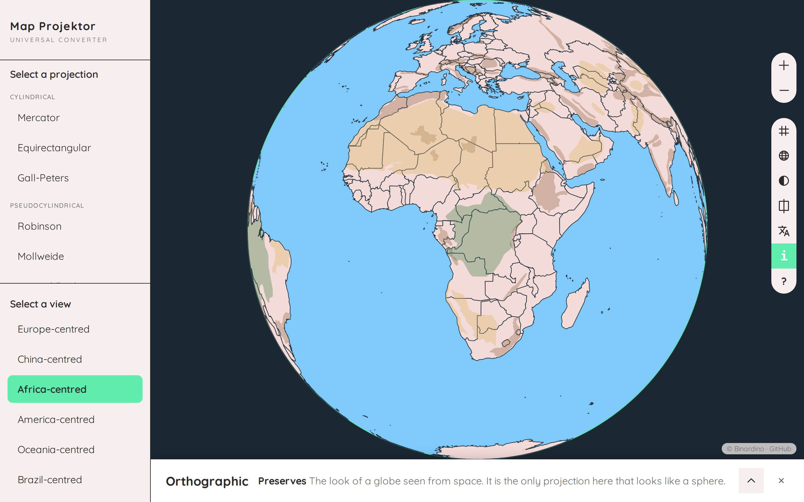
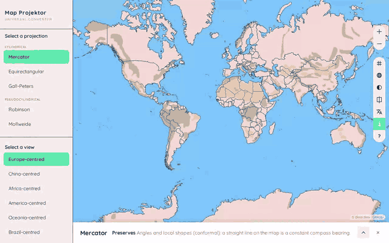
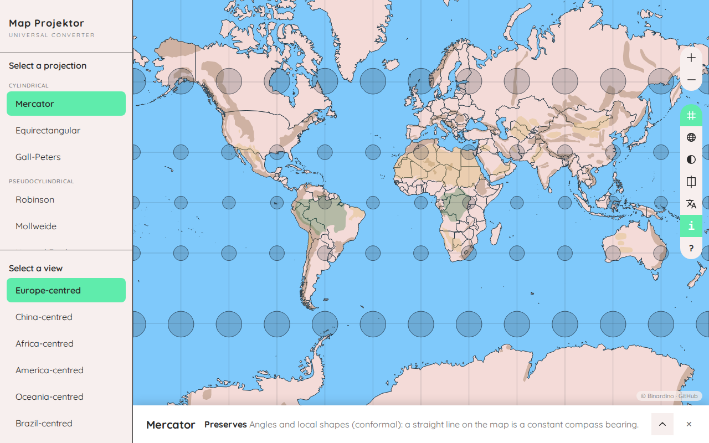
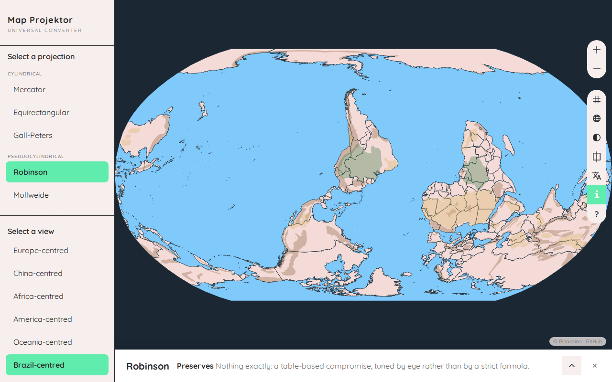
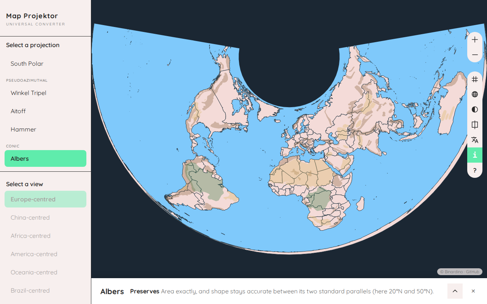
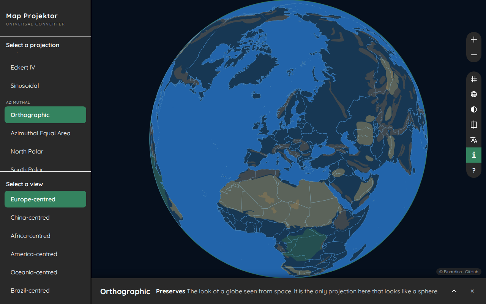

<h1 align="center">Map Projektor</h1>

<p align="center"><strong>The Universal Map Projection Converter</strong></p>

<p align="center">
  <a href="https://binardino.lauramini.fr/map-projektor/"><strong>▶ Try it live</strong></a>
</p>

<p align="center">
  <a href="https://github.com/Binardino/map-projektor/actions/workflows/tests.yml"></a>
</p>

<p align="center">
  An interactive world map that morphs between 20 cartographic projections,<br>
  so you can see what each one preserves and what it distorts.
</p>

<p align="center">
  
</p>

## See it move

Switching projection never snaps: the map morphs from one to the other, and routes through the globe when a polar view is involved.

<p align="center">
  
</p>

| | |
|---|---|
| <br>**Distortion grid** on Mercator | <br>**South-up view** on Robinson |
| <br>**Conic** projection (Albers) | <br>**Dark theme** on the globe |

## Features

- **20 projections in 7 families**: cylindrical, pseudocylindrical, azimuthal, pseudoazimuthal, conic, square and polyhedral, from Mercator to Equal Earth, plus a draggable 3D globe, two polar views, two square worlds (Spilhaus' world ocean map and Peirce's quincuncial), which the globe turns and unfolds into, and Fuller's Dymaxion map, which unfolds out of the globe triangle by triangle
- **Animated transitions**: the map morphs from one projection to the next instead of snapping; a switch to or from a polar view folds into the globe, spins, then unfolds
- **Six points of view**: Europe-, China-, Africa-, America- and Oceania-centred, and a south-up map. The Europe-centred default is a convention, not a fact of nature, and the chosen view carries over when you switch projection
- **Distortion grid**: Tissot's indicatrix, a grid of identical circles on the sphere that the projection stretches into ellipses, so you see where and how much it distorts
- **Reference lines**: equator, tropics, polar circles and meridians
- **Country size comparison**: pick up to 5 countries and drag them across the map; each one is moved on the sphere and projected again, so it stretches or shrinks exactly as the projection does at that place. They can also be drawn under another projection than the map's
- **Projection facts**: who created each projection and when, what it preserves, what it distorts, what it is best for, and one fact worth knowing about it, with a link to its Wikipedia article in your language
- **Navigation**: zoom with the buttons or the mouse wheel, drag to pan the map or to spin the globe
- **Shareable link**: the address bar always holds the projection and the view on screen, so copying it shares that exact map
- **Light and dark themes**, remembered between visits
- **18 languages**, country names included, Arabic and Urdu reading right to left: the app follows the browser's language and remembers a choice. Most translations were made by an AI, and the app says so
- **Guided tour** on the first visit, replayable from the toolbar: it opens by unfolding the globe into Mercator, then morphing it into Equal Earth, so you see the idea before touching anything
- **Mobile layout**: the sidebar becomes a drawer on small screens

## Quickstart

You need Python 3.10+ and [Poetry](https://python-poetry.org/).

```bash
git clone https://github.com/Binardino/map-projektor.git
cd map-projektor
poetry install
poetry run uvicorn app.main:app --reload
```

Open [http://localhost:8000](http://localhost:8000).

The map data is committed, so there is nothing to download first. The browser loads D3 from a CDN, so it needs internet access.

To refresh the data from Natural Earth (optional, needs internet access):

```bash
poetry run python scripts/fetch_geodata.py
```

Run the tests:

```bash
poetry run pytest -v
```

## Run with Docker

No Python or Poetry needed on your machine:

```bash
docker build -t map-projektor .
docker run -p 8000:8000 map-projektor
```

Or with Docker Compose:

```bash
docker compose up --build
```

Open [http://localhost:8000](http://localhost:8000). The container listens on `$PORT` (8000 by default), which is what most hosting platforms expect. The public site is published differently, as static files: see [docs/deployment.md](docs/deployment.md).

## Stack

| Layer | Technology |
|---|---|
| Server | FastAPI + uvicorn, Jinja2 template |
| Map | D3.js v7 + d3-geo-projection v4, drawn as SVG |
| Frontend code | Plain ES modules: no framework, no bundler, no npm |
| Data pipeline | Python (`requests` + `shapely`) on Natural Earth 1:50m data |
| Checks | pytest, Node's built-in test runner, Playwright |
| Packaging | Poetry, Docker |

## Contributing

Adding a projection takes one object in the registry and five strings. [CONTRIBUTING.md](CONTRIBUTING.md) explains how, where the code lives and which checks to run. The history of changes is in [CHANGELOG.md](CHANGELOG.md).

## Credits

- Map data: [Natural Earth](https://www.naturalearthdata.com/) (public domain), simplified and lightly corrected by `scripts/fetch_geodata.py`
- Projections and rendering: [D3](https://d3js.org/), [d3-geo-projection](https://github.com/d3/d3-geo-projection) and [d3-geo-polygon](https://github.com/d3/d3-geo-polygon) for Dymaxion (ISC license)
- Spilhaus projection: adapted from [riatelab/bertin](https://github.com/riatelab/bertin) (MIT License), after [Torben Jansen](https://observablehq.com/@toja/spilhaus-world-ocean-map-in-a-square)
- Typeface: [Quicksand](https://fonts.google.com/specimen/Quicksand) (SIL Open Font License); [Noto Sans](https://fonts.google.com/noto) for the other scripts (same license)
- Language icon: [Material Icons](https://fonts.google.com/icons) (Apache License 2.0)

## License

[MIT](LICENSE)
